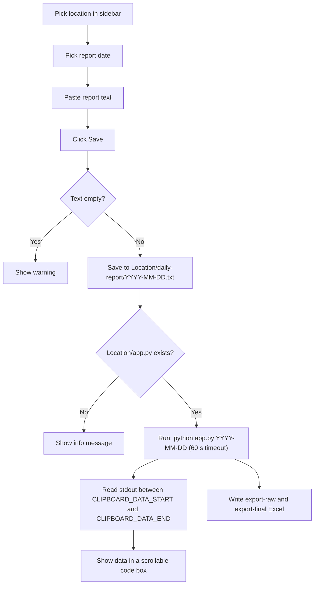
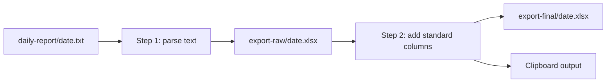

# Daily Drilling Report - Documentation

This project turns the daily drilling reports from each region/zone into **one standard Excel format** (19 columns) that can be pasted into the master report.

## Docs per location

| Location | Input | How you run it | Doc |
|---|---|---|---|
| Region 1 | Excel (`.xlsx`) | Streamlit page `pages/region-1.py` | [region-1.md](region-1.md) |
| Region 2 | Excel (`.xlsx`) | Streamlit page `pages/region-2.py` | [region-2.md](region-2.md) |
| Region 5 | Text (`.txt`) | Root `app.py` (sidebar: Region 5) | [region-5.md](region-5.md) |
| Zone 7 | Text (`.txt`) | Root `app.py` (sidebar: Zone 7) | [zone-7.md](zone-7.md) |
| Zone 8 | Text (`.txt`) | Root `app.py` (sidebar: Zone 8) | [zone-8.md](zone-8.md) |
| Zone 9 | Text (`.txt`) | Root `app.py` (sidebar: Zone 9) | [zone-9.md](zone-9.md) |
| Zone 10 | Text (`.txt`) | Root `app.py` (sidebar: Zone 10) | [zone-10.md](zone-10.md) |
| Zone 11 | Text (`.txt`) | Root `app.py` (sidebar: Zone 11) | [zone-11.md](zone-11.md) |

## Root `app.py` (text-based locations)

The root `app.py` is a small Streamlit form. It does **not** parse anything itself. It saves your pasted text and calls the `app.py` inside the selected location folder.

| Feature | What it does |
|---|---|
| Export location (sidebar) | Chooses the folder (`Region 5`, `Zone 5`-`Zone 11`). Default is Zone 7. Creates `daily-report/` if missing. |
| Stats | Counts `.txt` files already saved for that location. |
| Date picker + prev/next buttons | Sets the report date used as the file name. Default is today. |
| Save | Writes `YYYY-MM-DD.txt`, then runs the location processor. Overwrites if the date already exists. |
| Clipboard preview | Shows tab-separated rows (no header) that you can copy straight into Excel. |
| Saved files list | Lists `.txt` files with their size, newest first. |

Notes:
- Region 1 and Region 2 are not in the sidebar. They use Excel input and have their own upload pages.
- Zone 5 and Zone 6 are in the sidebar but have no `app.py` yet, so you only get the "app.py not found" message after saving.

## Shared pipeline (Region 5, Zone 7-10)

## Standard final columns

`Flag`, `Region`, `Zone`, `APH`, `Rig Name`, `Well Name`, `Well Name [2]`, `Well Type`, `Location`, `Spud Date`, `Release Date`, `Status`, `Status Code [1]`, `Status Code [2]`, `Summary Report`, `Current Status`, `Next Plan`, `Report Date`, `Operation Date`

Common rules in every location:
- `Flag` is always `INC`.
- `Operation Date` = `Report Date` minus 1 day.
- `Release Date`, `Status`, `Status Code [1]`, `Status Code [2]` are left blank.
- Text starting with `-` is cleaned so Excel does not read it as a formula.
