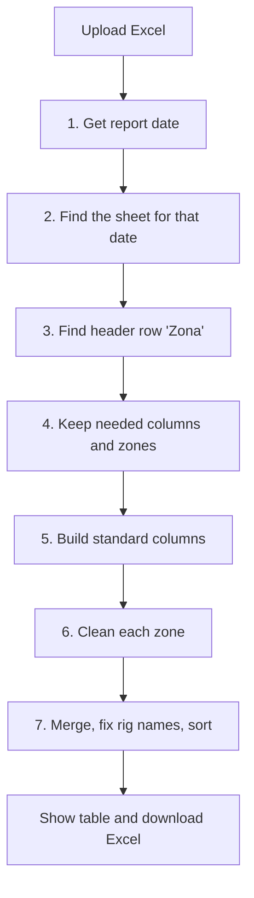
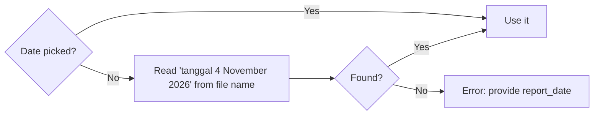
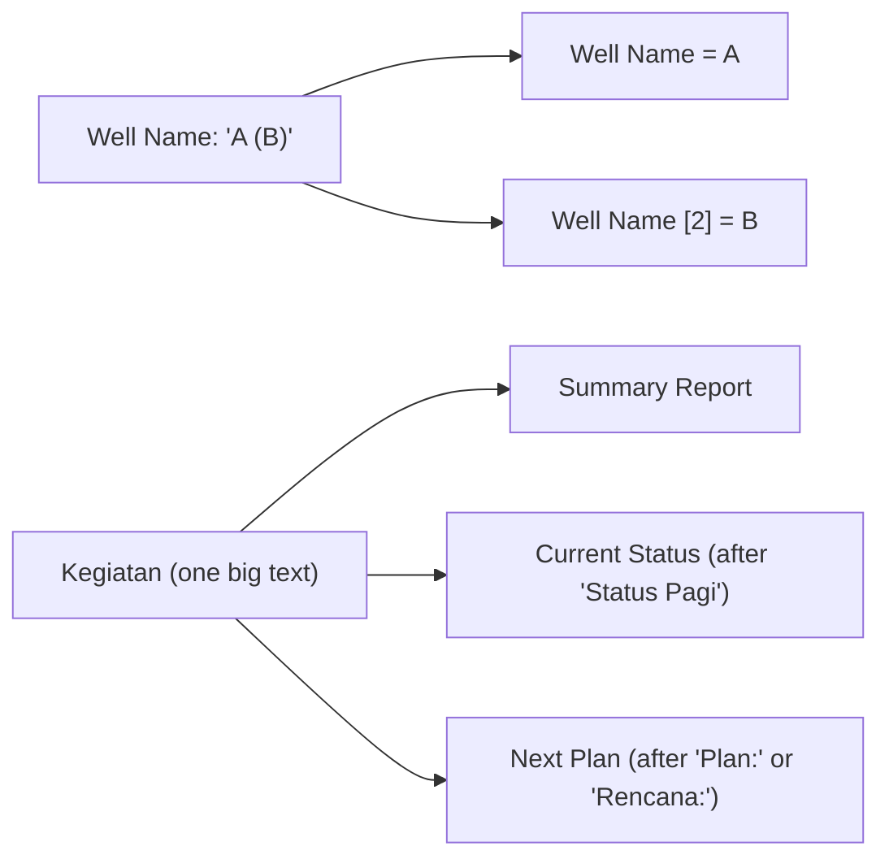

# Region 1

**Code:** `Region 1/app.py` (conversion logic) and `pages/region-1.py` (upload page)
**Input:** Excel report, e.g. `Laporan Harian Pemboran Regional 1 tanggal 4 November 2026.xlsx`
**Output:** `export-final/YYYY-MM-DD.xlsx` (CLI) or a downloaded Excel file (Streamlit page)

## Overall workflow



## Features

### 1. Report date detection
Gets the report date from the date picker (optional) or, if empty, from the file name (`tanggal DD Month YYYY`). English and Indonesian month names both work (`Mei`, `Agu`, `Okt`, `Des`, ...).



### 2. Sheet selection
Each workbook has one sheet per day (`4 November`, `01 Jan`, ...). The code converts every sheet name to a date and picks the one that equals the report date. If the date written in the sheet title is different, a warning is shown.

### 3. Header row detection
Searches for the row that contains the column title `Zona` and uses it as the header, so extra title rows above the table do not matter.

### 4. Column and zone filter
Keeps `Zona`, `Nama Sumur`, `RIG`, `Jenis Kegiatan`, `Kegiatan` and keeps only these zones:

| In the Excel | In the output |
|---|---|
| Zona 1 | Zone 1 |
| Zona 2 & 3 | Zone 2&3 |
| Zona 4 | Zone 4 |
| Non Operator, KSO | Non-Operator |

Columns are renamed to `Zone`, `Well Name`, `Rig Name`, `Well Type`, `Summary Report`.

### 5. Standard columns
| Column | Value |
|---|---|
| Flag | `INC` |
| Region | `Region 1` |
| Location | `Onshore` |
| APH | Zone 1 and Zone 4 = `PEP`, Zone 2&3 = `PHR`, Non-Operator = blank |
| Well Type | `Eksplorasi` becomes `Exploration` |
| Report Date | The report date |
| Operation Date | Report date minus 1 day |

### 6. Zone-specific cleaning
Every zone splits two messy text cells into clean columns.



| Zone | Special handling |
|---|---|
| Zone 1 | Well name accepts `A / B` or `A (B)`. Word "Rig" removed from rig name. |
| Zone 2&3 | Well name has up to 3 parts: `Name (Name2) (Name3)`. Summary text may start with `Laporan:`. Sorted by rig. |
| Zone 4 | Invisible character removed from well name. Rig names fixed (e.g. `PDSI ACS#21` becomes `ACS-21`). Sorted by rig. |
| Non-Operator | Rigs like `EPI#9` become `EPI-09`, `Bohai #26` becomes `Bohai-26`. |

### 7. Final merge
- Joins the four zone tables.
- Applies the rig rename table (e.g. `SO PEACE` becomes `SINOOCEAN PEACE`) and the patterns `TMMJ#18` to `TMMJ-18`, `GW265` to `GW-265`.
- Removes leading `-` from `Summary Report`, `Current Status`, `Next Plan`.
- Sorts by zone order (Zone 1, 2&3, 4, Non-Operator), then rig name.

### 8. Streamlit page
`pages/region-1.py`: upload `.xlsx`, optional report date, **Convert**, preview table, **Download Excel** (file name `YYYY-MM-DD.xlsx`). Errors (sheet not found, missing column) are shown in red.

### 9. Command line
```bash
python app.py "daily-report/08-2026/Laporan Harian Pemboran Regional 1 tanggal 8 November 2026.xlsx"
```
Accepts several files at once and writes each to `export-final/`.

## Input to output example (simplified)

| Zona | Nama Sumur | RIG | Kegiatan |
|---|---|---|---|
| Zona 4 | `ABC-01 (ABC-01X)` | `Rig PDSI #12.3/N110-M` | `Drilling ... Status Pagi: POOH Plan: RIH` |

becomes

| Zone | Rig Name | Well Name | Well Name [2] | Summary Report | Current Status | Next Plan |
|---|---|---|---|---|---|---|
| Zone 4 | PDSI #12.3/N110-M | ABC-01 | ABC-01X | Drilling ... | POOH | RIH |
