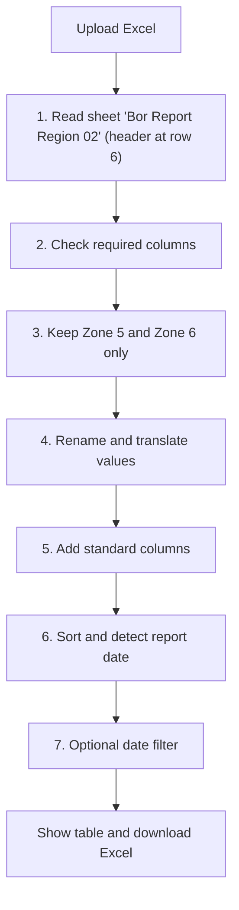
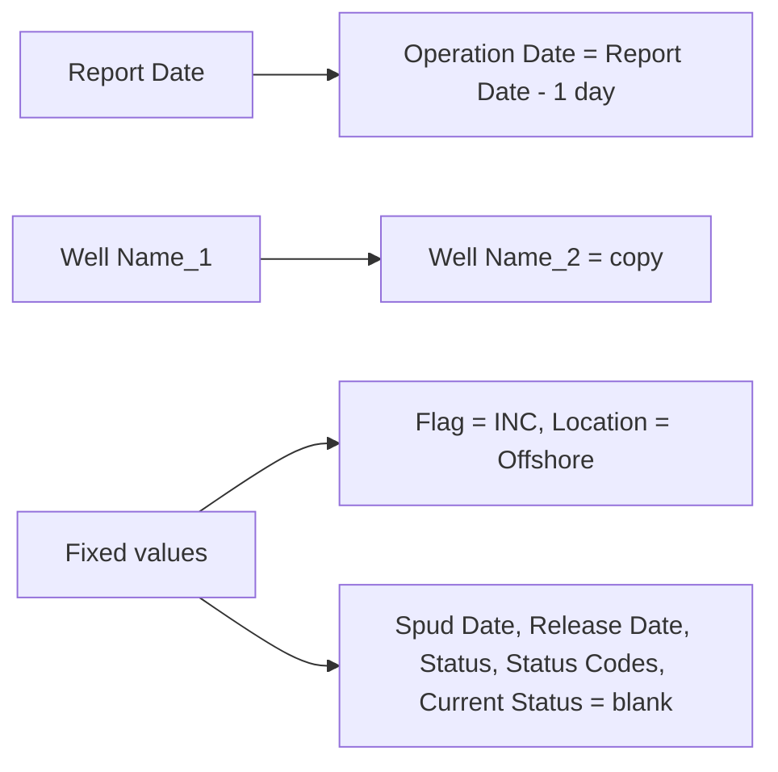

# Region 2

**Code:** `Region 2/app.py` (conversion logic) and `pages/region-2.py` (upload page)
**Input:** Excel workbook with the sheet `Bor Report Region 02`
**Output:** Downloaded Excel `YYYY-MM-DD.xlsx` (Streamlit page) or `export-final/YYYY-MM-DD.xlsx` (CLI, needs `daily-report/02-2026/sample.xlsx`)

## Overall workflow

## Features

### 1. Read the sheet
Reads the sheet `Bor Report Region 02` and uses row 6 as the header. If the sheet does not exist, an error message names the file.

### 2. Column check
These columns must exist, otherwise an error lists the missing ones:

| Excel column | Output column |
|---|---|
| Report Date | Report Date |
| Region | Region |
| Zone | Zone |
| Unit Name | Rig Name |
| Well Name/ Location | Well Name_1 |
| Job Type | Well Type |
| Summary | Summary Report |
| Next Plan | Next Plan |

### 3. Zone filter and value translation

| Field | Rule |
|---|---|
| Zone | Keep `Zone_05` and `Zone_06` only. Shown as `Zone 5`, `Zone 6`. |
| Region | `Reg_02` becomes `Region 2` |
| Well Type | `BOR EKS` becomes `Exploration`, `BOR DEV` becomes `Development` |
| APH | Zone 5 = `ONWJ`, Zone 6 = `OSES` |
| Rig Name | `PVD-I` is corrected to `PVD-II` |

### 4. Standard columns

The columns are then put in the standard order and sorted by Zone, then Rig Name.

### 5. Report date
The report date returned is the **latest** `Report Date` found in the data.

### 6. Streamlit page
`pages/region-2.py`:
1. Upload `.xlsx`, click **Convert**.
2. Preview the table.
3. Optional **Filter by date** checkbox. When on, only rows of the chosen date are shown and downloaded (useful when the sheet contains several days).
4. **Download Excel** (file name uses the filter date, or the report date).

## Input to output example (simplified)

| Zone | Unit Name | Job Type | Summary |
|---|---|---|---|
| Zone_05 | PVD-I | BOR DEV | Drilling 12 1/4 in. hole |

becomes

| Zone | APH | Rig Name | Well Type | Location | Summary Report |
|---|---|---|---|---|---|
| Zone 5 | ONWJ | PVD-II | Development | Offshore | Drilling 12 1/4 in. hole |
