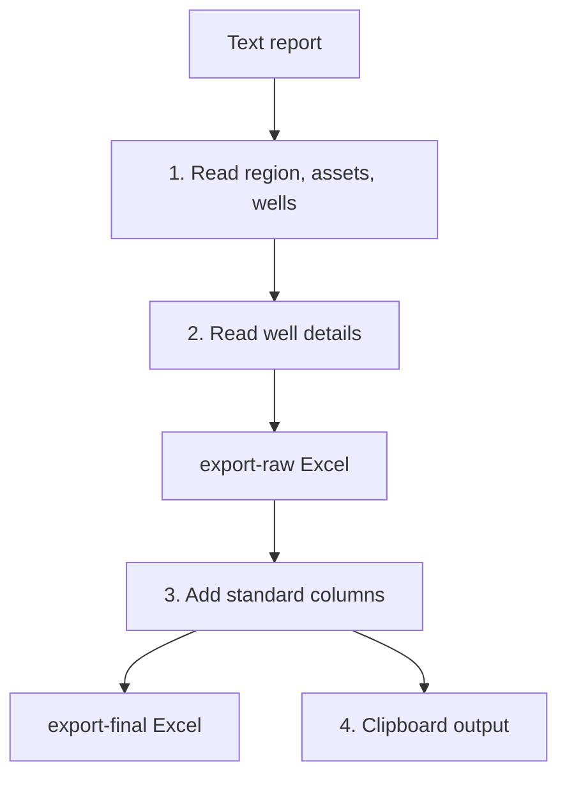
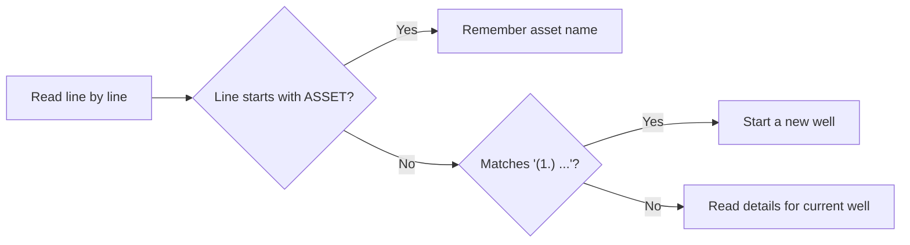

# Region 5

**Code:** `Region 5/app.py`
**Input:** `daily-report/YYYY-MM-DD.txt` (English report grouped by `ASSET`: Algeria, Iraq, Malaysia)
**Output:** `export-raw/YYYY-MM-DD.xlsx`, `export-final/YYYY-MM-DD.xlsx`, clipboard data

## Overall workflow



## Input format (simplified)

```text
Region name              <- first line
Report Date: 28 Dec 2025
ASSET ALGERIA
(1.) OHD – QB-117 (Rig ENAFOR 45)
* Spud date: 28 Dec 2025
* Current Operation 24 hrs: Drilling 8.5 in. hole ...
* 24 hrs look ahead: Continue drilling ...
```

## Features

### 1. Well detection


For a line like `(1.) OHD – QB-117 (Rig ENAFOR 45)`:
- Rig Name = text after `Rig` inside brackets (`ENAFOR 45`).
- Well Name = text after the dash, rig removed (`QB-117`).

### 2. Detail extraction
| Line starts with | Goes to column | Note |
|---|---|---|
| `* Spud date:` | Spud Date | Accepts `28 Dec 2025`, `28 December 2025`, `2025-12-28`, `28-12-2025`. Unreadable date becomes empty. |
| `* Current Operation 24 hrs:` | Current Operation | Continues over the next lines until the next `*` or `---`. |
| `* 24 hrs look ahead:` | 24 hrs look ahead | Same multi-line rule. |

Raw file columns: `Region`, `Asset`, `Rig Name`, `Well Name`, `Spud Date`, `Current Operation`, `24 hrs look ahead`.

### 3. Raw to final
| Column | Rule |
|---|---|
| Flag | `INC` |
| Region | Title case of the first line |
| Zone | Algeria = `Zone 15`, Iraq = `Zone 16`, Malaysia = `Zone 17` |
| APH | `PIEP` |
| Well Name_2 | Copy of Well Name |
| Well Type | `Development` |
| Location | Algeria and Iraq = `Onshore`, Malaysia = `Offshore` |
| Report Date | Date from the command line / Streamlit date |
| Operation Date | Report Date minus 1 day |
| Release Date, Status, Status Codes, Current Status | Blank |
| Asset | Removed |

Final column order ends with `Current Operation`, `Current Status`, `24 hrs look ahead`, `Report Date`, `Operation Date`. Rows are sorted by Zone, Rig Name, Well Name.

> Region 5 keeps its own text column names (`Current Operation`, `24 hrs look ahead`) instead of `Summary Report` / `Next Plan`.

### 4. Clipboard output
The final table (no header, tab separated) is copied to the clipboard when run in a local terminal. It is also printed between `CLIPBOARD_DATA_START` and `CLIPBOARD_DATA_END`, so the Streamlit app can show it.

### 5. Command line and validation
```bash
python app.py 2026-01-18
```
- Date must be `YYYY-MM-DD`.
- Errors: missing text file, or no wells found.
- Run it from inside the `Region 5` folder (the root `app.py` does this automatically).
