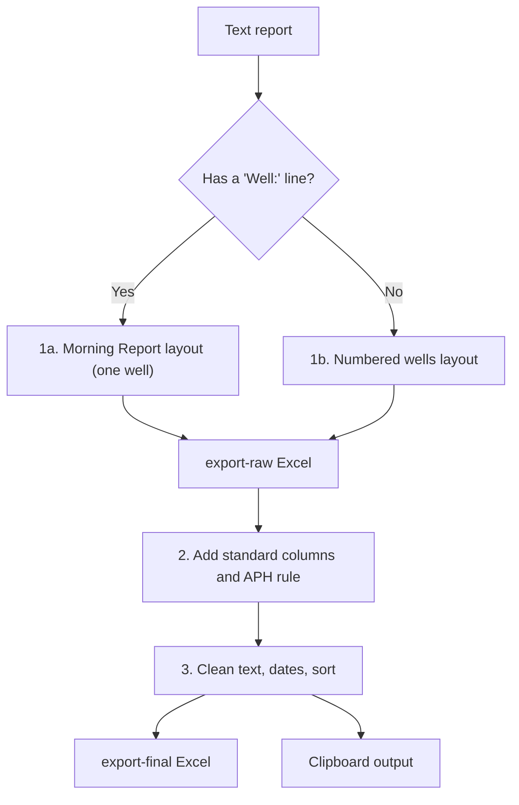
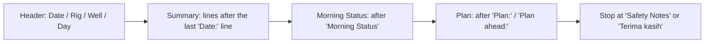
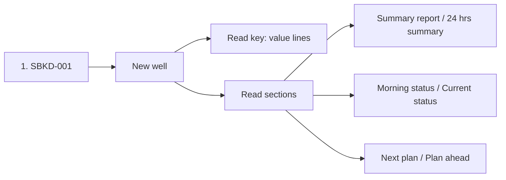

# Zone 10

**Code:** `Zone 10/app.py`
**Input:** `daily-report/YYYY-MM-DD.txt` (Indonesian "Laporan Pagi Drilling Zona-10")
**Output:** `export-raw/YYYY-MM-DD.xlsx`, `export-final/YYYY-MM-DD.xlsx`, clipboard data

## Overall workflow



## Features

### 1. Layout detection
Zone 10 reports come in two shapes. The code checks for a line starting with `Well:`.

| Layout | How to recognise | Rows produced |
|---|---|---|
| Morning Report (single well) | Has `Well:` line | 1 |
| Numbered wells | `1. SBKD-001`, `2. ...` | 1 per well |

Invisible characters (e.g. U+200E) and `*` are removed from every line first.

### 1a. Morning Report layout

- Well = value of `Well:`; Rig = value of `Rig:` (trailing period removed).
- Each section's lines are joined into one paragraph.

### 1b. Numbered wells layout

| Label | Raw column |
|---|---|
| Nama Sumur / Well Name | Nama Sumur |
| Nama Rig / Rig Name | Nama Rig ("Rig" prefix removed) |
| AFE | AFE (number) |
| Realisasi biaya | Realisasi Biaya (value before `(`) |
| Summary report | Summary Report |
| Morning / Current status | Morning Status |
| Next plan | Next Plan |

A section ends when the parser meets another section header, a new numbered well, or a known field label (`Hari ke`, `Kedalaman`, `Progres`, `AFE`, `DSR`, ...). Section lines are joined with spaces.

### 2. Raw to final
| Column | Rule |
|---|---|
| Flag | `INC` |
| Region | `Region 3` |
| Zone | `Zone 10` |
| APH | `PHKT`, or `LPB` if the rig name contains `PDSI` |
| Well Name / Rig Name | From Nama Sumur / Nama Rig |
| Well Name [2] | Copy of Well Name |
| Current Status | From Morning Status |
| Well Type | `Development` |
| Location | `Onshore` |
| Report Date / Operation Date | Input date / minus 1 day (date only) |
| Spud Date, Release Date, Status, Status Codes | Blank |

AFE and Realisasi Biaya stay in the raw file only.

### 3. Text cleaning and sorting
- Leading `-` on the first line is removed (Excel formula safety), then leading `-`, `:`, `=` are stripped.
- Rows are sorted by Rig Name (case-insensitive).

### 4. Clipboard output
Final rows (no header, tab separated) are copied to the clipboard locally and printed between `CLIPBOARD_DATA_START` / `CLIPBOARD_DATA_END` for Streamlit.

### 5. Command line and validation
```bash
python app.py 2025-04-26
```
- Date must be `YYYY-MM-DD` and a real date.
- Creates `daily-report/` if missing.
- Clear error boxes for: missing file, no wells found, missing columns, unexpected errors.
