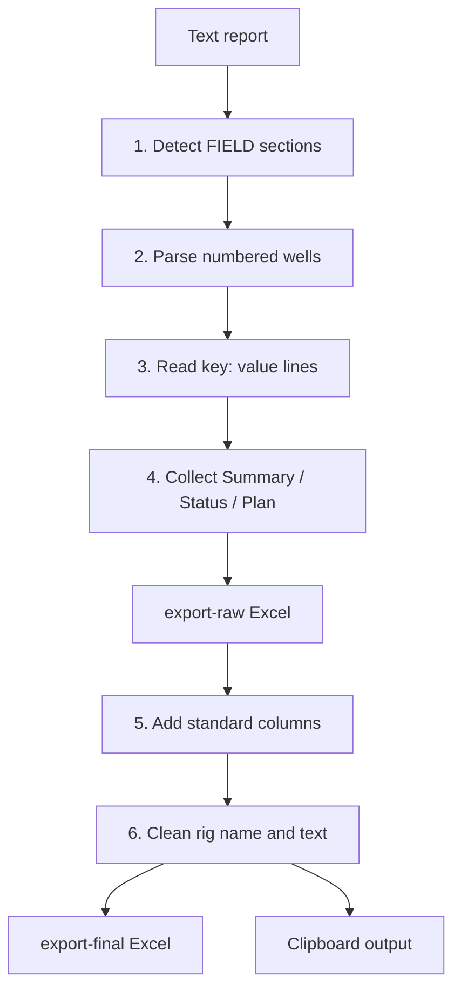
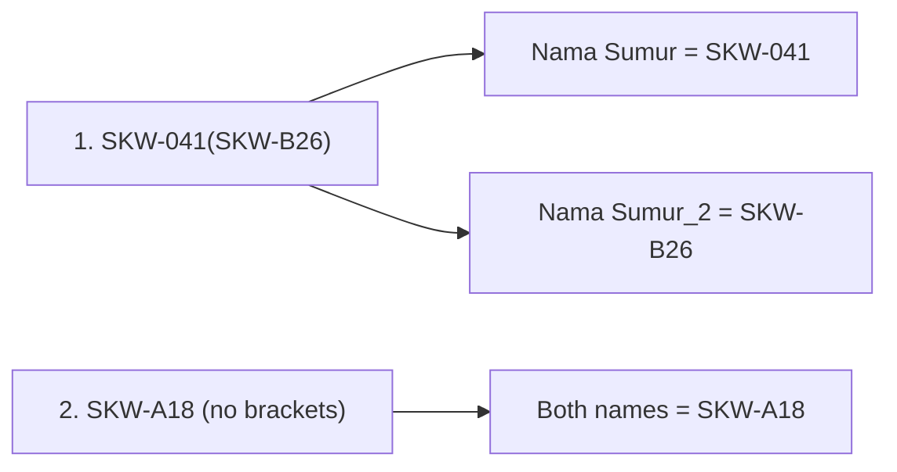
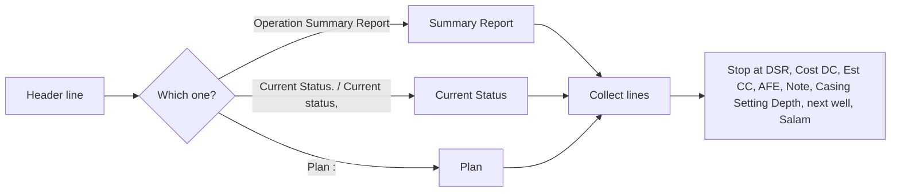

# Zone 11

**Code:** `Zone 11/app.py`
**Input:** `daily-report/YYYY-MM-DD.txt` (Indonesian "Laporan Pagi Drilling Zona 11")
**Output:** `export-raw/YYYY-MM-DD.xlsx`, `export-final/YYYY-MM-DD.xlsx`, clipboard data

Fixed values: **Region 4**, **Zone 11**, **APH = PEP**.

## Overall workflow



## Input format (simplified)

```text
*Laporan Pagi Drilling Zona 11, tanggal 8 November 2026*
Highlights Operation : ...                  <- ignored (before first well)

*FIELD SUKOWATI*
*1. SKW-041(SKW-B26)*
Nama Lokasi : SKW-B26
Nama Rig : Rig PDSI#40.3/ DS-1500E
H: 04; D: 977 ftMD/967.47 ftTVD; P: 862 ft   <- day count (or "Rig Moving & Rig Up (MIRU), H: 7")
Company Man / HSSE Kord / Rig Supt : ...
Casing Setting Depth (Plan / Actual) : ...   <- ignored
Operation Summary Report :
...
Current Status.
...
Plan :
...
DSR @24 : ...
Cost DC : US$ 77,468.95
Est CC  : US$ 1,014,133.53 (9.07%)
AFE Cost: US$ 11,180,955
Note : ...                                   <- ignored
Salam
```

## Features

### 1. Field detection
A line starting with `FIELD` sets the field (e.g. `SUKOWATI`). Everything before the first well (title, highlights) is skipped. `*` and invisible characters are removed from every line.

### 2. Well name and second name


### 3. Key: value lines
| Label | Raw column | Note |
|---|---|---|
| Nama Lokasi | Nama Lokasi | |
| Nama Rig | Nama Rig | Prefix "Rig" removed |
| `H: 04` / `..., H: 7` | Hari ke | Integer |
| Company Man, HSSE Kord, Rig Supt | Same names | Text |
| DSR @24 | DSR | Text |
| Cost DC, Est CC, AFE Cost | Same names | Numbers. Handles `1,014,133.53` and `1.292.656,75`; text in brackets like `(9.07%)` is ignored |

### 4. Multi-line sections

- Lines are kept one per row inside the cell (bullets stay readable).
- The header can end with `:`, `.` or `,`. Text on the same line as the header is kept.
- `Note :` and `Casing Setting Depth` are not exported.

### 5. Raw to final
| Column | Rule |
|---|---|
| Flag | `INC` |
| Region | `Region 4` |
| Zone | `Zone 11` |
| APH | `PEP` |
| Well Name / Well Name [2] | Nama Sumur / Nama Sumur_2 (falls back to Well Name) |
| Rig Name | Nama Rig, cleaned (see below) |
| Next Plan | From `Plan` |
| Well Type | `Development` |
| Location | `Onshore` |
| Report Date / Operation Date | Input date / minus 1 day (date only) |
| Spud Date, Release Date, Status, Status Codes | Blank |

Field, location, day count, crew, DSR and costs stay in the raw file only.

### 6. Rig name and text cleaning
| Example in report | Final |
|---|---|
| `PDSI#40.3/ DS-1500E` | `PDSI #40.3/DS-1500E` |
| `PDSI #04.3/N110M` | `PDSI #04.3/N110-M` |

Rules: `PDSI#` becomes `PDSI #`, spaces around `/` are removed, then the rename table `RIG_RENAMES` is applied (add new rig fixes there). Leading `-`, `=`, `+`, `@`, `:` are removed from the text columns so Excel does not read them as formulas. Rows are sorted by Rig Name (case-insensitive).

### 7. Clipboard output
Final rows (no header, tab separated) are copied to the clipboard locally and printed between `CLIPBOARD_DATA_START` / `CLIPBOARD_DATA_END` for Streamlit.

### 8. Command line
```bash
python app.py 2026-11-08
```
Date must be `YYYY-MM-DD`. Paths are based on the `Zone 11` folder. Errors: missing text file, no wells found.

## Assumptions to confirm
- `Well Type` = `Development` and `Location` = `Onshore` (not given, copied from the other zones; Sukowati is a land field).
- `Spud Date` is left blank. The report mentions "Spud in ... tmt 07 November 2026" inside the summary text, so it could be extracted later.
