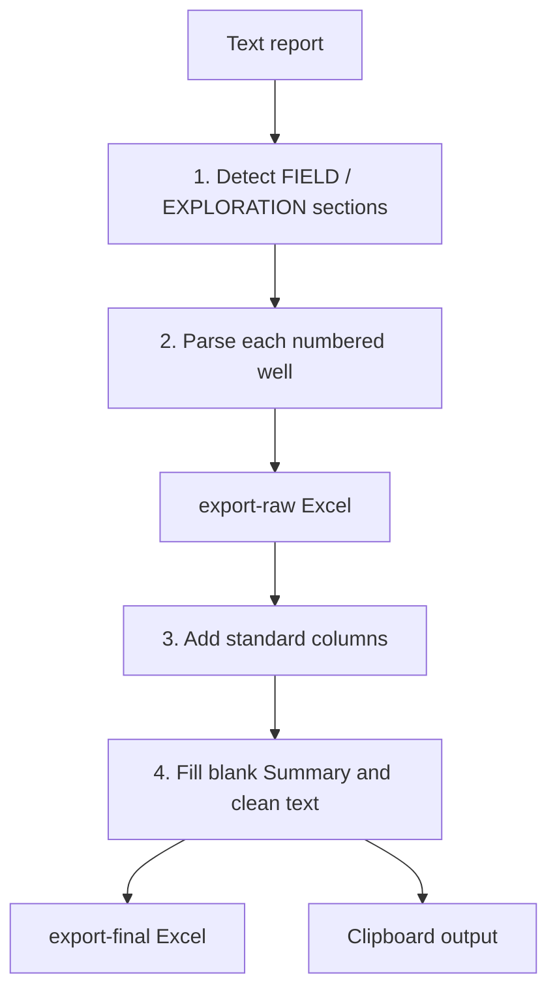
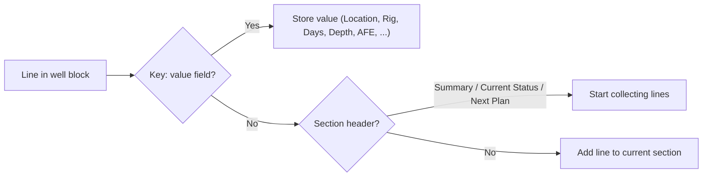
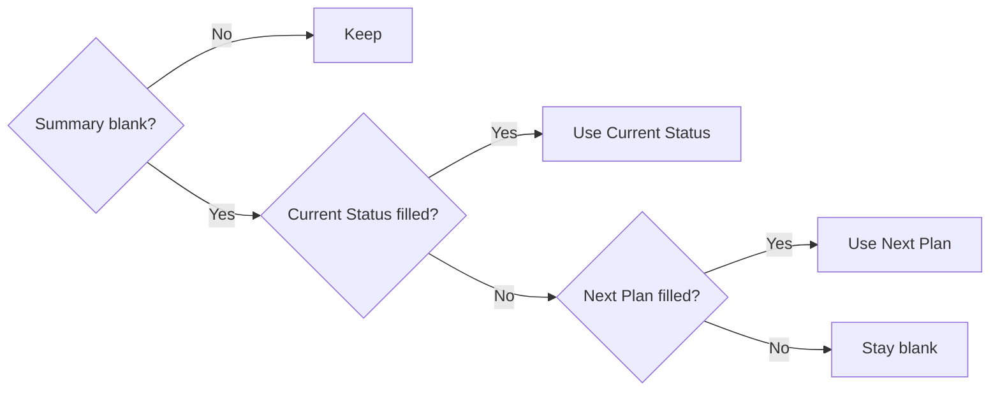

# Zone 7

**Code:** `Zone 7/app.py`
**Input:** `daily-report/YYYY-MM-DD.txt` (Indonesian "Laporan Pagi Pemboran PEP")
**Output:** `export-raw/YYYY-MM-DD.xlsx`, `export-final/YYYY-MM-DD.xlsx`, clipboard data

## Overall workflow



## Input format (simplified)

```text
FIELD JATIBARANG
1. AMJ-004
Nama Lokasi : ...
Rig Name    : PDSI#12.3/N110-M
Coman on    : ...
Hari ke     : 15
Kedalaman   : ...
Summary report : ...
Current status : ...
Next plan      : ...
EXPLORATION
2. XYZ-001
...
HSSE Report ...
Terima kasih
```

## Features

### 1. Section detection
| Line | Meaning |
|---|---|
| `FIELD <name>` | Starts a development field. Well Type = `Development`. |
| `EXPLORATION` | Starts exploration wells. Field = `EXPLORATION`, Well Type = `Exploration`. |
| `1. WELL-NAME` | Starts a well (only after a field/exploration header). |

### 2. Well parsing
The parser reads from a well's number line until the next well, next field, `HSSE Report`, `Terima kasih` or `Salam`.



| Report label | Raw column |
|---|---|
| (well number line) | Well Name |
| Nama Lokasi / Location | Location Name |
| Rig Name (`PDSI#12.3` becomes `PDSI #12.3`) | Rig Name |
| Coman on | Company Man |
| Hari ke / Day | Days |
| Kedalaman / Depth | Depth |
| Summary report | Summary |
| Current status | Current Status |
| Next plan | Next Plan |

DSR, AFE and Realisasi are read but not written to the raw file.

### 3. Raw to final
| Column | Rule |
|---|---|
| Flag | `INC` |
| Region | `Region 2` |
| Zone | `Zone 7` |
| APH | `PEP` |
| Well Name_2 | Copy of Well Name |
| Well Type | From the section (Development / Exploration) |
| Location | `Onshore` |
| Report Date / Operation Date | Input date / minus 1 day |
| Spud Date, Release Date, Status, Status Codes | Blank |

Dropped from final: Field, Location Name, Company Man, Days, Depth.

### 4. Summary fallback and text cleaning

Leading `-` on the first line of Summary, Current Status and Next Plan is removed so Excel does not treat it as a formula. The final column is named `Summary`. Rows are sorted by Zone, Rig Name, Well Name.

### 5. Clipboard output
Final rows (no header, tab separated) are copied to the clipboard locally and printed between `CLIPBOARD_DATA_START` / `CLIPBOARD_DATA_END` for Streamlit.

### 6. Command line
```bash
python app.py 2026-01-19
```
Date must be `YYYY-MM-DD`. Errors: missing text file, no wells found.
