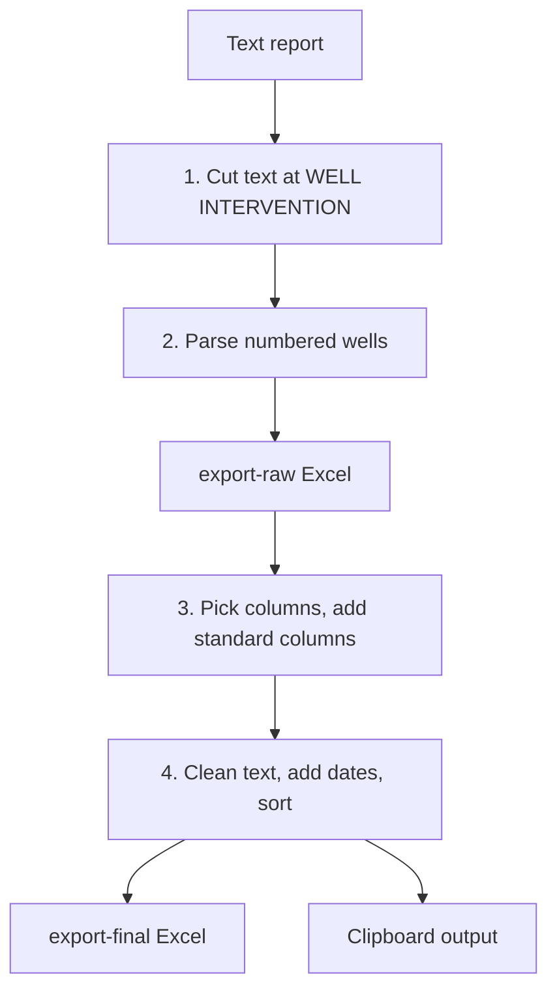
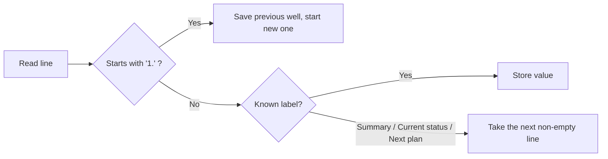

# Zone 8

**Code:** `Zone 8/app.py`
**Input:** `daily-report/YYYY-MM-DD.txt` (Indonesian "Laporan Harian DWI PHM")
**Output:** `export-raw/YYYY-MM-DD.xlsx`, `export-final/YYYY-MM-DD.xlsx`, clipboard data

## Overall workflow



## Input format (simplified)

```text
1.
Nama Sumur : ABC-01
Nama Rig   : PDSI #xx
Hari ke    : 12
Kedalaman  : 2500 mMD
Progres    : 120 mMD
AFE        : 1,000,000
Realisasi biaya : 500,000
EMD        : 20/02/2026
Summary report
- Drilling ...
Current status
- POOH ...
Next plan
- RIH ...
WELL INTERVENTION   <- everything after this is ignored
```

## Features

### 1. Text preparation
- Everything from the keyword `WELL INTERVENTION` onward is removed (only drilling wells are reported).
- Characters `*` and `_` are removed from every line.

### 2. Well parsing


| Label | Raw column | Note |
|---|---|---|
| Nama Sumur | Nama Sumur | |
| Nama Rig | Nama Rig | |
| Hari ke | Hari ke | Integer |
| Kedalaman | Kedalaman (mMD) | Number |
| Progres | Progress (mMD) | Number |
| AFE | AFE | Digits only |
| Realisasi biaya | Realisasi Biaya | Commas removed |
| EMD | EMD | Parsed as day-first date |
| Summary report / Current status / Next plan | Same names | Only the **first non-empty line** after the label is taken |

### 3. Raw to final
Only `Nama Sumur`, `Nama Rig`, `Summary Report`, `Current Status`, `Next Plan` are carried over.

| Column | Rule |
|---|---|
| Flag | `INC` |
| Region | `Region 3` |
| Zone | `Zone 8` |
| APH | `PHM` |
| Well Name / Rig Name | From Nama Sumur / Nama Rig |
| Well Name [2] | Copy of Well Name |
| Well Type | `Development` |
| Location | `Offshore` |
| Spud Date, Release Date, Status, Status Codes | Blank |

### 4. Cleaning, dates and sorting
- Leading `-`, `:` or `=` removed from Summary Report, Current Status, Next Plan.
- `Report Date` = input date, `Operation Date` = input date minus 1 day (date only).
- Sorted by Rig Name, case-insensitive.

Hari ke, depth, progress, AFE, cost and EMD stay in the raw file only.

### 5. Clipboard output
Final rows (no header, tab separated) are copied to the clipboard locally and printed between `CLIPBOARD_DATA_START` / `CLIPBOARD_DATA_END` for Streamlit.

### 6. Command line
```bash
python app.py 2026-01-03
```
Date must be `YYYY-MM-DD`. Errors: missing text file, no wells found.
