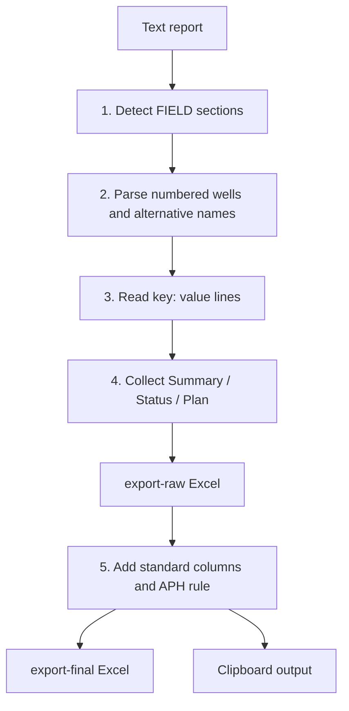
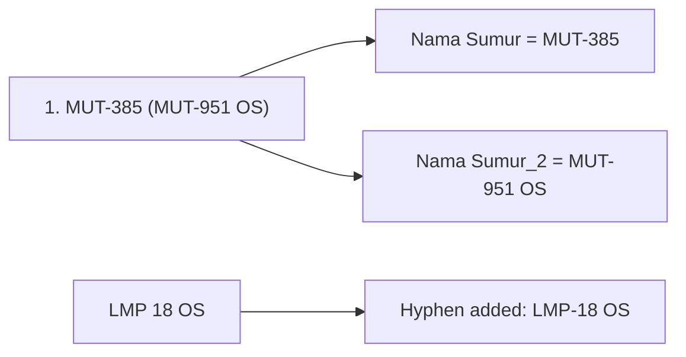
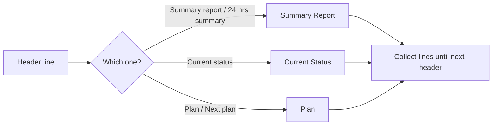

# Zone 9

**Code:** `Zone 9/app.py`
**Input:** `daily-report/YYYY-MM-DD.txt` (Indonesian "Laporan Pagi Drilling Region 3 Zona 9")
**Output:** `export-raw/YYYY-MM-DD.xlsx`, `export-final/YYYY-MM-DD.xlsx`, clipboard data

## Overall workflow



## Input format (simplified)

```text
FIELD SANGASANGA
1. MUT-385 (MUT-951 OS)
Nama Rig : Rig PDSI #21.2/OW 700-M
Hari ke  : D-34
AFE Cost : 1,000,000
Realisasi Biaya : 500,000 (50%)
Summary Report
- Drilling ...
Current Status
- POOH ...
Plan
- RIH ...
Tim Drilling
```

## Features

### 1. Field detection
A line starting with `FIELD` sets the field (Sangasanga, Sangatta, Mutiara, Semberah, Nilam). Duplicate headers like `FIELD SEMBERAH FIELD SEMBERAH` are handled.

### 2. Well name and alternative name


### 3. Key: value lines
| Label (any case) | Raw column | Note |
|---|---|---|
| Nama Rig / Rig Name | Nama Rig | Prefix "Rig" removed |
| WOL Hari ke | WOL Hari ke | Number (Wait On Location days) |
| Hari ke / Days / Drilling Day | Hari ke | Text kept, e.g. `D-34`, `M-8` |
| AFE ... | AFE Cost | Number |
| Realisasi / Est Cumulative Cost | Realisasi Biaya | Value before `(` only |

### 4. Multi-line sections

- Text after the colon on the header line is kept.
- Bullets `-` / `=` and banners are stripped from each line.
- The "Plan - Actual" casing table header is not treated as a plan.
- `Tim Drilling` (report footer) or a new `FIELD` ends the section.

### 5. Raw to final
| Column | Rule |
|---|---|
| Flag | `INC` |
| Region | `Region 3` |
| Zone | `Zone 9` |
| APH | `PHSS`, or `PEP` if the rig name contains `PDSI` |
| Well Name / Well Name [2] | Nama Sumur / Nama Sumur_2 (falls back to Well Name) |
| Rig Name | Nama Rig (`PDSI#21.2/OW 700-M` fixed to `PDSI #21.2/OW 700-M`) |
| Next Plan | From `Plan` |
| Well Type | `Development` |
| Location | `Onshore` |
| Report Date / Operation Date | Input date / minus 1 day |
| Spud Date, Release Date, Status, Status Codes | Blank |

Leading `-`, `:`, `=` are removed from the text columns. Rows are sorted by Rig Name (case-insensitive). Field, days and costs stay in the raw file only.

### 6. Clipboard output
Final rows (no header, tab separated) are copied to the clipboard locally and printed between `CLIPBOARD_DATA_START` / `CLIPBOARD_DATA_END` for Streamlit.

### 7. Command line
```bash
python app.py 2026-02-03
```
Date must be `YYYY-MM-DD`. Paths are based on the `Zone 9` folder, so it works from any directory.
